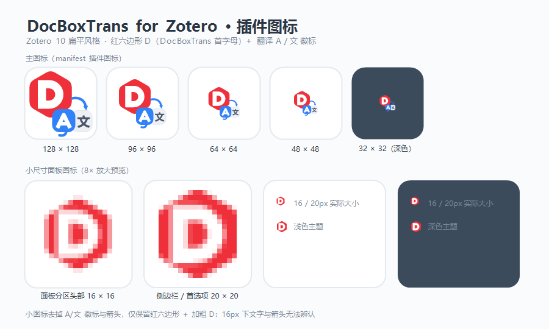

# DocBoxTrans for Zotero

> 面向 [Zotero](https://www.zotero.org/) 内置 PDF 阅读器的划词翻译插件，移植了 [DocBoxTrans](../DocBoxTrans) 的多翻译引擎与「上下文增强翻译」。

选中文献中的文本即可弹出翻译卡片；译完的记录沉淀在「翻译记录」侧栏，可检索、打标签、按原文顺序重排，并一键跳回原文位置。



---

## 兼容性

插件清单声明的最低支持版本为 Zotero 7（`strict_min_version: 6.999`）。目前开发与测试主要在 **Zotero 10** 上完成，**尚未逐一验证全部功能在 Zotero 7 上均可正常使用**；若需在较低版本上使用，请先自行测试，并欢迎反馈问题。

---

## 功能特性

- **阅读器划词翻译**：在 Zotero 内置阅读器中选中文本，弹出翻译卡片；开启「自动翻译」后选中即译，无需再点按钮。
- **翻译记录侧栏**：通过 Zotero 条目面板 / 阅读器左侧导航的「翻译记录」分区查看全部译文，支持：
  - 关键字搜索、标签筛选；
  - 按**翻译时间**或**原文前后顺序**排序（原文顺序兼容双栏 PDF 的阅读次序）；
  - 单击记录展开 / 收起，一键复制、删除、按范围清空（单文件 / 整篇文献）；
  - 点击记录可**跳回原文在文档中的位置**。
- **拼接翻译**：把分散在文档各处的句子「加入拼合区」，再一次性整体翻译；提供快捷键（默认 `Alt+Shift+A` 加入、`Alt+Shift+S` 翻译），适合图表说明、跨页段落。
- **上下文增强翻译**：把此前成功翻译的「原文 → 译文」作为参考注入大模型，统一术语与表达；按条目 / 文件隔离，避免不同文献互相串味；可在弹窗与侧栏一键开关。
- **多翻译源**：大模型（任意 OpenAI 兼容接口）、谷歌、必应、腾讯交互、有道智云、知网，共 6 个引擎，弹窗与侧栏均可切换。
- **请求级译文复用**：同一原文命中历史时直接复用旧译文，避免重复请求。
- **设置面板**：在 Zotero「设置 → DocBoxTrans」中集中配置翻译服务、密钥、上下文与快捷键等。
- **中英双语界面**：内置 `zh-CN` 与 `en-US` 本地化。

---

## 安装

### 方式一：从发布版安装（推荐）

1. 在 Releases 页面下载插件的 `.xpi` 文件。
2. Zotero 中打开「工具 → 附加组件」，点击右上角齿轮 → 「Install Add-on From File…」，选择该 `.xpi`。
3. 重启 Zotero 后即可使用。

> 插件声明支持 Zotero 7 及以上；当前主要在 Zotero 10 上测试（完整兼容性说明见上文）。安装后在「设置 → DocBoxTrans」中至少填写大模型的 `apiKey`（使用大模型翻译时）。

### 方式二：从源码构建

见下文 [开发与构建](#开发与构建)。

---

## 使用说明

### 阅读器划词翻译

- 在内置 PDF 阅读器中**选中文本**，随后在弹窗中查看译文；开启「自动翻译」则选中即译。
- 弹窗内可切换翻译服务、开关「上下文增强」与「拼接」，并直接复制译文。
- 关闭「显示翻译弹窗」后，结果只出现在「翻译记录」侧栏。

### 翻译记录侧栏

- 阅读器左栏与文献条目面板均提供「翻译记录」分区：阅读器按**当前文件**隔离，条目面板按**整篇文献**汇总。
- 记录卡片支持展开、复制、删除、打标签（输入时可实时匹配已有标签），并可点击跳回原文。

### 拼接翻译

- 开启「拼接」后，新选区会自动加入拼合区并暂停自动翻译；也可用快捷键 `Alt+Shift+A` 加入。
- 按 `Alt+Shift+S`（或侧栏「翻译」按钮）对拼合区内容整体翻译。

---

## 偏好设置

偏好前缀为 `extensions.zotero.DocBoxTrans`，可在 Zotero「设置 → DocBoxTrans」中修改。

### 翻译服务

| 偏好键 | 默认值 | 说明 |
| --- | --- | --- |
| `translateSource` | `llm` | 当前翻译服务（`llm`/`google`/`bing`/`tencent`/`youdao`/`cnki`） |
| `targetLanguage` | `zh-CN` | 目标语言 |
| `showServiceSelector` | `true` | 是否在弹窗中显示服务选择器 |
| `fontSize` | `12` | 结果字号 |

### 翻译行为

| 偏好键 | 默认值 | 说明 |
| --- | --- | --- |
| `enableAuto` | `true` | 选中文本后自动翻译 |
| `enablePopup` | `true` | 是否显示翻译弹窗（关闭后结果仅进翻译记录） |
| `reuseTranslation` | `true` | 请求级译文复用 |
| `combineAddShortcut` | `Alt+Shift+A` | 拼接：把选区加入拼合区 |
| `combineTranslateShortcut` | `Alt+Shift+S` | 拼接：翻译拼合区 |

### 上下文增强

| 偏好键 | 默认值 | 说明 |
| --- | --- | --- |
| `contextEnable` | `false` | 上下文增强开关（需所选服务具备上下文能力） |
| `contextMaxItems` | `4` | 单次请求最多引用的历史条目数 |
| `contextMaxChars` | `1500` | 单次请求上下文（原文+译文）合计字符上限 |

### 大模型（llm）

| 偏好键 | 默认值 | 说明 |
| --- | --- | --- |
| `llm.endpoint` | `https://api.deepseek.com/v1/chat/completions` | OpenAI 兼容接口地址 |
| `llm.apiKey` | *(空)* | API 密钥 |
| `llm.model` | `deepseek-chat` | 模型名 |
| `llm.temperature` | `0.2` | 采样温度 |
| `llm.systemPrompt` | *(内置翻译提示词)* | 系统提示词 |

### 有道智云

| 偏好键 | 默认值 | 说明 |
| --- | --- | --- |
| `youdao.appKey` / `youdao.secret` | *(空)* | 有道智云应用 ID / 密钥 |
| `youdao.mode` | `auto` | `auto`（跟随上下文开关）/ `text` / `llm` |

### 其它引擎端点

| 偏好键 | 说明 |
| --- | --- |
| `google.endpoint` / `google.proxy` | 谷歌翻译接口地址与代理 |
| `bing.endpoint` | 必应翻译接口地址 |
| `tencent.endpoint` | 腾讯交互翻译接口地址 |
| `cnki.tokenUrl` / `cnki.api` | 知网 token 与翻译接口地址 |
| `cnki.maxChars` | 知网单次请求字符上限（默认 `500`，超出自动分批） |

---

## 翻译服务

| 服务 id | 名称 | 需密钥 | 上下文能力 |
| --- | --- | --- | --- |
| `llm` | 大模型 | 需 `llm.apiKey` | ✅ |
| `google` | 谷歌翻译 | 否 | ❌ |
| `bing` | 必应翻译 | 否 | ❌ |
| `tencent` | 腾讯交互翻译 | 否 | ❌ |
| `youdao` | 有道翻译 | 需 appKey/secret | ⚙️ 取决于模式 |
| `cnki` | 知网翻译 | 否 | ❌ |

> 上下文能力只是必要条件，是否真正携带上下文还取决于「上下文增强」是否开启。

---

## 开发与构建

基于 [zotero-plugin-scaffold](https://github.com/northword/zotero-plugin-scaffold) 构建，需 Node.js 18+。

```bash
npm install      # 安装依赖

npm start        # 启动开发（zotero-plugin serve）
npm run build    # 类型检查并构建插件（产物位于 build/，含 .xpi）
npm run release  # 生成可发布的 Release 资源
```

> 开发调试需在本机配置 Zotero 可执行文件路径（见脚手架文档 / `zotero-cmd.json`）。

---

## 项目结构

```
DocBoxTrans-Zotero/
├─ src/
│  ├─ index.ts              插件入口
│  ├─ hooks.ts              生命周期钩子（启动、阅读器弹窗、偏好加载等）
│  ├─ addon.ts              Addon 基类封装
│  ├─ modules/
│  │  ├─ reader.ts          阅读器划词事件接入
│  │  ├─ popup.ts           阅读器翻译弹窗（服务切换 / 上下文 / 拼接 / 结果）
│  │  ├─ context.ts         上下文增强（会话级、按条目隔离）
│  │  ├─ historyPane.ts     「翻译记录」侧栏（列表 / 筛选 / 标签 / 排序 / 跳转）
│  │  ├─ preferenceWindow.ts 设置面板
│  │  ├─ defaultPrefs.ts    首次启动偏好修正
│  │  └─ services/          六个翻译引擎（llm/google/bing/tencent/youdao/cnki）
│  └─ utils/                配置、历史存储、HTTP、本地化等工具
├─ addon/                   清单、图标、偏好默认值与本地化（zh-CN / en-US）
├─ build/                   构建产物
├─ icon.svg                 源图标
└─ package.json
```

---

## 许可协议

本项目基于 [MIT License](../LICENSE) 开源。

## 免责声明

- 部分翻译源为第三方**非官方公开接口**，仅供个人学习与研究使用，请勿用于商业用途或高频批量调用。
- 请妥善保管偏好中的各类密钥。
- 使用本插件产生的任何后果由使用者自行承担。
