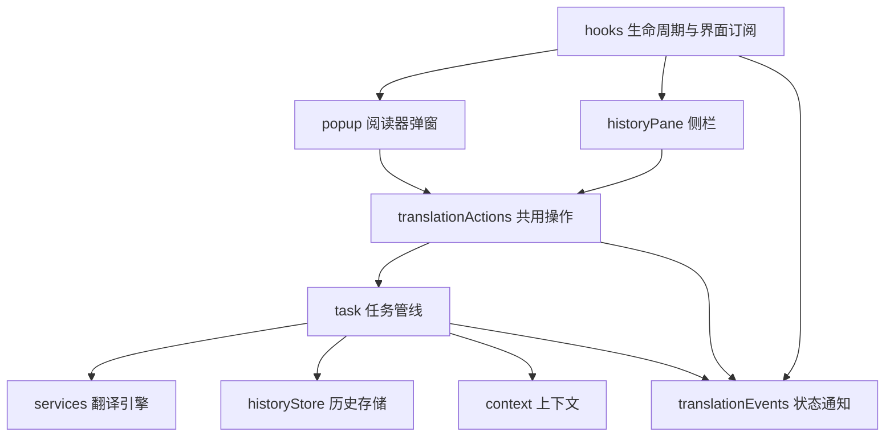

# 代码结构与扩展入口

本项目已完成稳定性修复、结构整理和第三阶段阅读体验更新。流式译文、取消与强制重译、PDF 文本清理和拼接排序均沿用统一任务管线。术语表和笔记导出属于后续功能阶段。

## 翻译管线



图中箭头表示模块依赖。通知模块本身不导入任何界面；`hooks.ts` 在启动时订阅变化，再刷新弹窗和侧栏，关闭时取消订阅。

- `translationActions.ts`：选区翻译、重译、追加片段、拼接翻译及成功后的片段清理。侧栏和弹窗共用这些操作，不相互调用。
- `utils/task.ts`：创建任务、取消过期请求、译文复用、上下文快照、结果校验和提交。状态与历史记录由此处统一更新。
- `services/base.ts`：定义只读的 `TranslationRequest`、`TranslationContext` 和返回类型 `TranslationResult`。
- `utils/translationEvents.ts`：发布是否刷新弹窗的通知。侧栏仍接收关闭弹窗时的任务更新；单个监听器失败不会改变翻译任务的成功状态。
- `services/chatStream.ts`：增量解析大模型 SSE，检查完整结束标记，仅向管线传递可见译文。
- `utils/text.ts`、`combineChips.ts`：PDF 文本清理、片段重叠处理和两处界面共用的片段排序控件。

### 添加翻译引擎

在 `src/modules/services/` 实现并注册 `TranslateService`：

```ts
const translate: TranslateService["translate"] = async (request, context) => {
  const response = await httpJson("POST", endpoint, {
    body: JSON.stringify({ text: request.raw, target: request.langto }),
    signal: request.signal,
  });
  return { text: response.translation };
};
```

引擎只读取请求并返回译文；不要写入任务的 `status`、`result`，不要保存历史或刷新界面。接口错误抛出 `TranslateError`，空结果由管线按失败处理。分批请求也需传递取消信号。

流式引擎可调用 `request.onProgress?.(累计译文)`，但仍须返回最终完整结果。管线检查请求是否仍然有效，节流发布 `progressOnly` 通知，仅刷新结果区。`runTranslationTask` 的 `force` 选项绕过历史复用，取消及错误不会保存部分结果。

## 翻译记录侧栏

`historyPane.ts` 负责注册分区、建立工具条、协调刷新和持有面板集合。其余职责位于 `src/modules/history/`：

| 文件 | 职责 |
| --- | --- |
| `types.ts` | 面板范围、筛选与排序类型 |
| `scope.ts` | 当前附件或文献范围、面板独立筛选状态和文本匹配 |
| `sorting.ts` | 原文顺序、附件先后和旧位置数据的排序兜底 |
| `layout.ts` | 高度计算、合并布局调度、窗口监听和观察器释放 |
| `controls.ts` | 按钮、开关和复制等基础控件 |
| `tags.ts` | 标签胶囊、候选建议和内联编辑器 |
| `recordCard.ts` | 历史卡片、展开折叠、复制删除和原文定位 |
| `currentTranslation.ts` | 当前译文区、服务切换和拼接区 |

卡片与当前译文区通过回调请求刷新，不导入侧栏入口。面板销毁和插件关闭时，布局模块释放窗口监听器、`ResizeObserver`、动画帧及延迟任务。

## 验证

执行 `npm test` 和 `npm run build`。

- `tests/stability.test.cjs` 延续上一阶段的稳定性回归测试。
- `tests/structure.test.cjs` 覆盖六个引擎的返回约定、通知隔离、实际侧栏模块的搜索/标签/排序/跳转/多阅读器交互，以及资源释放。
- 测试还扫描全部生产 TypeScript 模块，检查运行时导入图中没有循环依赖，类型导入不计入运行时依赖。
- `tests/dom.cjs` 仅提供离线交互所需的最小 DOM，不验证浏览器像素布局。真实 Zotero 验收仍参照 [验收清单](stability-validation.md)。

当前保留包版本 `0.3.7`，构建产物更新为本轮代码，尚未发布。
