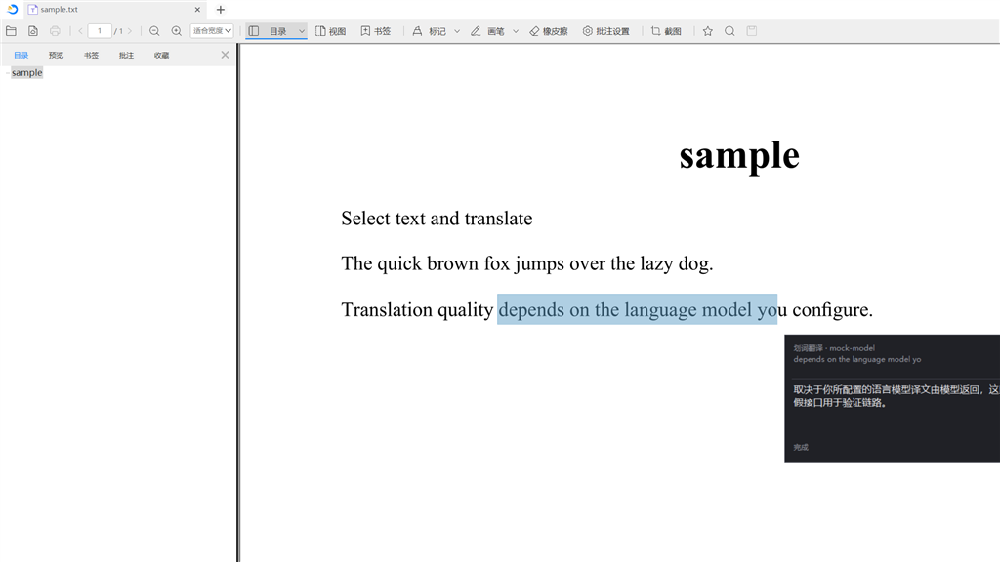

# DocBoxTrans

> 面向 [稻壳阅读器](https://www.docbox.cn/)（DocBox）的 Windows 划词翻译工具：**一键取词、浮窗译文、历史留档、上下文增强**。

DocBoxTrans 是一个常驻托盘的轻量翻译助手。它针对「在稻壳阅读器里读 PDF / 外文文献」这一场景做了深度优化：按下热键即可翻译当前选区，译文以**不抢焦点**的卡片浮窗展示，可连续取词、无需反复点击；翻译历史本地留存，并支持把前文译文作为参考注入大模型，提升术语与上下文一致性。




---

## 目录

- [功能特性](#功能特性)
- [翻译服务](#翻译服务)
- [快速开始](#快速开始)
- [使用说明](#使用说明)
- [配置说明](#配置说明)
- [与稻壳阅读器的联动](#与稻壳阅读器的联动)
- [本地 HTTP 接口](#本地-http-接口)
- [项目结构](#项目结构)
- [从源码构建](#从源码构建)
- [常见问题](#常见问题)
- [相关项目](#相关项目)
- [许可协议](#许可协议)
- [免责声明](#免责声明)

---

## 功能特性

- **划词即译**：默认热键 `Ctrl+Y`，模拟 `Ctrl+C` 取词后自动翻译，结果以浮窗呈现；也可用 `Alt+Shift+Q` 直接翻译剪贴板内容。
- **不抢焦点的结果浮窗**：无边框圆角卡片、置顶但不激活，翻译后选区不会被清掉，可以连续取词翻译。支持拖动、右下角缩放、主题配色与高 DPI 自适应。
- **划词工具条**：鼠标拖选结束后在光标旁弹出「译 / 存」小工具条，**在拖选结束瞬间取词并缓存**，避免点击按钮后再取词的时序问题。
- **暂存拼接**：`Alt+C`（或工具条「存」）暂存当前选中内容，下次翻译时与本次选中自动拼接，便于把分散的句子合起来翻译。
- **翻译历史**：每次成功翻译自动保存原文与译文，历史窗口按时间倒序展示，支持标签标注与按标签筛选；本地留存，不上传。
- **上下文增强翻译**：把此前成功翻译的「原文 → 译文」作为参考注入大模型，统一术语与表达。仅对具备上下文能力的服务生效（大模型、有道大模型模式），可在浮窗中一键清空。
- **按文档隔离**：以「进程名｜窗口标题」作为文档身份，历史去重与上下文参考都限定在同篇文档内，避免多篇 PDF 互相串味。
- **标签页跟随**：切换阅读器标签页 / 换文档时，浮窗与历史窗口自动跟随——切走自动隐藏，切回自动恢复对应内容与显隐状态。
- **PDF 文本预处理**：自动合并 PDF 取词产生的「不合理换行」（句末标点、列表项、疑似新句子等一律保留），明显提升机器翻译质量。
- **多服务切换**：内置大模型（OpenAI 兼容）、谷歌、必应、腾讯交互、有道智云、知网共 6 个翻译源，浮窗底部胶囊一键切换，可配置显示哪些服务。
- **本地 HTTP 接口**：可选开启回环地址接口，供外部程序（含稻壳）直接把文本送进来翻译，绕开模拟 Ctrl+C 取词的脆弱环节。
- **随稻壳启停**：内置守卫进程，实现「开稻壳 → 起翻译，关稻壳 → 关翻译」，并可写入开机自启。
- **零第三方依赖**：纯 .NET Framework 编写，用 Windows 自带的编译器即可构建，无需安装 .NET SDK。

---

## 翻译服务

| 服务 id | 名称 | 是否需密钥 | 上下文能力 | 说明 |
| --- | --- | --- | --- | --- |
| `llm` | 大模型 | 需填 `api_key` | ✅ 具备 | 任意 OpenAI 兼容接口（DeepSeek / 通义 / 智谱 / Kimi / 本地 Ollama 等） |
| `google` | 谷歌翻译 | 否 | ❌ | 免费接口，支持备用端点轮换以应对限流 |
| `bing` | 必应翻译 | 否 | ❌ | 免费接口 |
| `tencent` | 腾讯交互翻译 | 否 | ❌ | 免费接口 |
| `youdao` | 有道翻译 | 需填 appKey/secret | ⚙️ 取决于模式 | `auto` / `text` / `llm` 三种模式，`auto` 跟随「上下文增强」开关 |
| `cnki` | 知网翻译 | 否 | ❌ | 术语翻译，单次长度受限会自动分批 |

> 上下文能力只是**必要条件**：是否真正携带上下文，还取决于是否在托盘菜单勾选「上下文增强翻译」。

---

## 快速开始

### 方式一：直接运行（推荐）

1. 下载/构建得到 `DocBoxTrans.exe` 与 `DocBoxTransConfig.exe`。
2. 将两个 exe、`DocBoxTrans.ico`、`config.ini` 放在同一目录（`config.ini` 不存在时会自动生成默认配置）。
3. 运行 `DocBoxTransConfig.exe` 完成首次配置：**至少填写 `api_key`**（使用大模型时），并确认热键、目标进程等设置。
4. 运行 `DocBoxTrans.exe`，程序常驻系统托盘。
5. 打开稻壳阅读器，选中一段文字，按 `Ctrl+Y` 即可看到译文浮窗。

### 方式二：从源码构建

见 [从源码构建](#从源码构建)。

---

## 使用说明

### 热键

| 动作 | 默认热键 | 配置项 |
| --- | --- | --- |
| 翻译当前选中内容（模拟 Ctrl+C 取词） | `Ctrl+Y` | `hotkey` |
| 直接翻译剪贴板内容 | `Alt+Shift+Q` | `hotkey_clipboard` |
| 暂存当前选中内容（与工具条「存」等价） | `Alt+C` | `hotkey_stash` |

> 修饰键支持 `Alt` / `Ctrl` / `Shift` / `Win`，可组合（如 `Ctrl+Alt+T`）。留空即不注册该热键。
> 默认 `only_in_docbox=1`，热键**仅在稻壳阅读器前台时生效**；调试时可改为 `0`，让任意窗口都能触发。

### 结果浮窗

- 拖动标题区移动，拖动右下角抓手缩放，浮动内容随译文多少自动伸缩。
- 底部胶囊行显示可选翻译服务（最多同时展示 3 个，超出可用滚轮或拖动切换），点击即切换并重译。
- 左上角标题可勾选调整要显示的服务；标题栏按钮提供「历史」开关与「清空上下文」。
- 「复制译文」一键复制；「原文」区默认折叠，展开后可滚动查看全文。

### 划词工具条

在目标窗口拖选文字后，光标旁会弹出极小工具条：

- **译**：立即翻译本次拖选的文字；
- **存**：暂存本次拖选的文字，下次翻译时自动拼接。

### 历史窗口

- 展示成功翻译记录（最新在顶部），支持标签标注与标签筛选。
- 按「来源文档」隔离，默认仅显示当前打开文档的记录。
- 关闭窗口为隐藏而非删除；显示状态与配置同步，重启后恢复。

---

## 配置说明

配置为 INI 风格文本文件 `config.ini`。**推荐用 `DocBoxTransConfig.exe` 修改**——它按分组列出每项的名称、当前值与取值说明，选中即可行内修改并立即写回，因此 `config.ini` 本身无需注释。

保存配置并正常退出后，正在运行的 `DocBoxTrans.exe` 会收到通知并**自动重载配置**，无需重启。也可在托盘菜单里手动「重新加载配置」。

主要配置分组：

| 分组 | 关键项 |
| --- | --- |
| 热键 | `hotkey`、`hotkey_clipboard`、`hotkey_stash` |
| 触发范围 | `only_in_docbox`、`docbox_process` |
| 取词 | `use_selection`、`restore_clipboard`、`fallback_to_clipboard`、`clipboard_wait_ms`、`clear_clipboard_after_capture` |
| 文本预处理 | `preprocess_text` |
| 划词工具条 | `toolbar_enable`、`toolbar_drag_threshold` |
| 翻译历史 | `history_max`、`history_width`、`history_height` |
| 上下文增强 | `context_enable`、`context_max_items`、`context_max_chars` |
| 翻译服务 | `service`、`enabled_services`、`proxy`、`target_lang` 及各引擎接口地址 |
| 大模型 | `api_base`、`api_path`、`api_key`、`model`、`temperature`、`timeout_seconds`、`max_chars`、`system_prompt` |
| 浮窗 | `popup_width`、`font_size`、`auto_close_seconds`、`dark_theme` |
| 本地接口 | `local_enable`、`local_port`、`local_token` |
| 生命周期 | `exit_with_docbox`、`lifecycle_check_ms` |

> 示例：把 `api_base` 指向本地 Ollama（`http://127.0.0.1:11434/v1`）即可离线使用大模型翻译。

---

## 与稻壳阅读器的联动

稻壳阅读器是闭源软件，无法在其内部挂载启动逻辑；而仅替换快捷方式或文件关联，又会被「双击 PDF、其它程序调用、重装覆盖关联」等路径绕过。因此 DocBoxTrans 采用一个**无界面、无托盘的守卫进程**（约 1.5 秒轮询一次）实现可靠的联动：

| 命令行参数 | 作用 |
| --- | --- |
| `--watch` | 以隐藏守卫进程运行：检测稻壳启动/退出并拉起或结束翻译工具 |
| `--install-autostart` | 写入开机自启并立即启动守卫 |
| `--uninstall-autostart` | 取消开机自启并停止守卫 |
| `--stop-watcher` | 仅停止守卫 |

相关配置：`exit_with_docbox`（随稻壳退出）、`lifecycle_check_ms`（轮询间隔）。

---

## 本地 HTTP 接口

开启 `local_enable=1` 后，程序仅监听 **回环地址** `127.0.0.1`（默认端口 `17635`），不对外网开放：

| 方法 | 路径 | 说明 |
| --- | --- | --- |
| `POST` | `/translate` | 请求体（或 `?text=`）为原文，返回译文文本 |
| `POST` | `/selection` | 请求体（或 `?text=`）为原文，触发浮窗展示（与热键一致），返回 `ok` |

当 `local_token` 非空时，请求需携带请求头 `X-DocBox-Token: <令牌>` 校验。

```bash
curl -X POST "http://127.0.0.1:17635/translate" --data "Hello world"
```

该接口让外部程序（包括稻壳阅读器本身）可以直接送文本进来翻译，**绕开「模拟 Ctrl+C + 轮询剪贴板」这一较脆弱的取词方式**。

---

## 项目结构

```
DocBoxTrans/
├─ src/
│  ├─ Program.cs            主程序：托盘、热键、取词、按文档隔离与标签页跟随
│  ├─ AppConfig.cs          配置模型与 config.ini 读写
│  ├─ ConfigCli.cs / ConfigCliMain.cs   命令行配置界面（DocBoxTransConfig.exe）
│  ├─ Lifecycle.cs          与稻壳联动的生命周期（守卫进程、开机自启）
│  ├─ Native.cs             Win32 P/Invoke（键鼠钩子、DWM 圆角等）
│  ├─ PopupForm.cs          翻译结果浮窗
│  ├─ HistoryForm.cs        翻译历史窗口
│  ├─ HistoryStore.cs / HistoryRecord.cs   历史记录持久化
│  ├─ ToolbarForm.cs        划词工具条
│  ├─ TagPromptForm.cs      历史标签输入
│  ├─ ResizeGrip.cs         浮窗/历史窗口缩放抓手
│  ├─ RoundLabel.cs         圆角标签等自绘控件
│  ├─ Translator.cs / ITranslateEngine.cs  引擎分派与统一接口
│  ├─ LlmEngine.cs / GoogleEngine.cs / BingEngine.cs
│  ├─ TencentEngine.cs / YoudaoEngine.cs / CnkiEngine.cs   各翻译引擎
│  ├─ TranslateSupport.cs   引擎共用 HTTP / JSON 辅助
│  ├─ TranslateResult.cs    结构化翻译结果（统一成功/失败标志）
│  ├─ TextPreprocessor.cs   PDF 文本换行预处理
│  ├─ TranslationContext.cs 会话级上下文（供大模型参考）
│  └─ LocalServer.cs        本地 HTTP 接口
├─ build.ps1                构建脚本
├─ DocBoxTrans.ico          应用图标（内嵌为 Win32 图标 / 托盘取帧）
├─ config.ini               运行配置（首次运行自动生成）
├─ 效果预览.png / 浮窗预览.png   截图
└─ README.md
```

---

## 从源码构建

无需安装 .NET SDK，直接使用 Windows 自带的 .NET Framework 编译器即可：

```powershell
# 在 DocBoxTrans 目录下执行
./build.ps1
```

产物：

| 文件 | 说明 |
| --- | --- |
| `DocBoxTrans.exe` | 主程序（GUI / 托盘） |
| `DocBoxTransConfig.exe` | 配置界面（控制台，交互式修改 `config.ini`） |

构建脚本使用 `%WINDIR%\Microsoft.NET\Framework\v4.0.30319\csc.exe`，源文件以 UTF-8（`/codepage:65001`）编译。

---

## 常见问题

**Q：在稻壳里按热键没反应？**
确认 `only_in_docbox=1` 时稻壳阅读器处于前台，且 `docbox_process=DocBox` 与实际进程名一致；也可临时改为 `only_in_docbox=0`，用记事本等任意程序测试热键是否正常。

**Q：取词不准 / 选区取不到？**
程序默认通过模拟 `Ctrl+C` 取词，对少数受保护内容可能失败。可开启本地 HTTP 接口，让外部程序直接送文本；或调节 `clipboard_wait_ms`、`fallback_to_clipboard`。

**Q：上下文增强没生效？**
需同时满足两个条件：托盘菜单已勾选「上下文增强翻译」，且当前服务具备上下文能力（大模型，或有道的 `auto`/`llm` 模式）。

**Q：多篇 PDF 的历史/译文怎么不串了？**
程序按文档身份隔离历史与上下文；若需全局汇总，可关闭 `isolate_by_origin`。

**Q：如何避免占用剪贴板？**
`clear_clipboard_after_capture=1` 会在取词后清空本次写入；若想恢复取词前的剪贴板内容，设 `restore_clipboard=1`。

---

## 相关项目

- **[DocBoxTrans for Zotero](../DocBoxTrans-Zotero/)**：同一仓库中的姊妹项目，把 DocBoxTrans 的翻译引擎与「上下文增强翻译」移植到 Zotero 阅读器，在 Zotero 内划词翻译。

---

## 许可协议

本项目基于 [MIT License](../LICENSE) 开源。

---

## 免责声明

- 本工具的部分翻译源为第三方**非官方公开接口**（谷歌 / 必应 / 腾讯 / 知网等），仅供个人学习与研究使用，请勿用于商业用途或高频批量调用，并遵守各服务方的服务条款。
- 请妥善保管 `config.ini` 中的各类密钥，**不要将其提交到公开仓库**。
- 使用本工具产生的任何后果由使用者自行承担。
